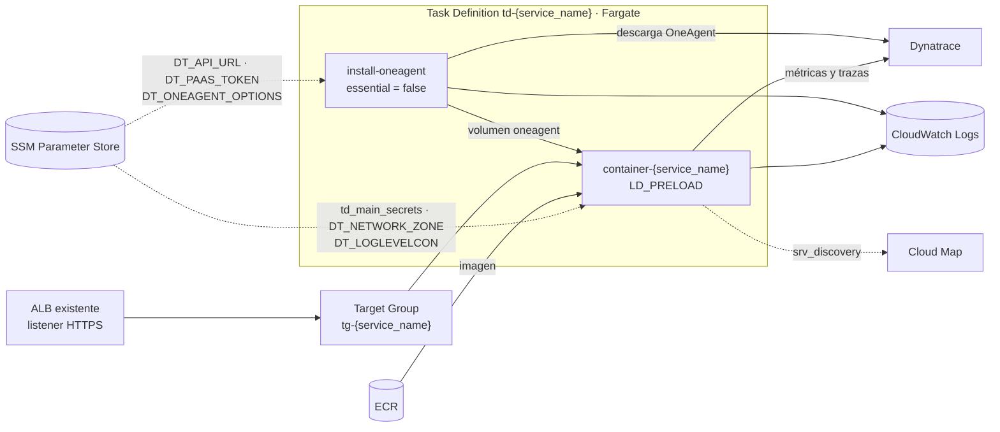

# terraform-aws-ecs-dynatrace 🚀

[](https://developer.hashicorp.com/terraform)
[](https://aws.amazon.com/fargate/)
[](https://www.dynatrace.com/)
[](LICENSE)

Infraestructura como código (Terraform) para desplegar microservicios (`ms-`) y microfrontends (`mfe-`) en **AWS ECS Fargate** sobre clusters **ya existentes**, con **Dynatrace OneAgent** inyectado en cada tarea mediante un contenedor sidecar.

## ✨ Características

- **Observabilidad sin tocar tu imagen.** Un sidecar instala OneAgent en un volumen compartido; tu servicio lo carga con `LD_PRELOAD`.
- **Un servicio por corrida.** La configuración vive en archivos JSON; el código de Terraform no cambia entre servicios.
- **Agnóstico de cuenta.** Los ARN (rol, SSM, ECR) se arman con la cuenta de las credenciales activas y la región configurada (`aws_region`).
- **Despliegues seguros.** Circuit breaker con rollback automático, root filesystem de solo lectura y tareas sin IP pública.
- **ECR cuidado.** Escaneo de imágenes al subirlas, cifrado KMS y lifecycle policy que conserva las últimas 10 imágenes.
- **Service discovery opcional** con AWS Cloud Map.

## 🏗️ Arquitectura



Por cada servicio se crea:

| Recurso | Módulo |
|---|---|
| Repositorio ECR + lifecycle policy | `ecr` |
| Log group de CloudWatch | `cloudwatch` |
| Target Group + Listener Rule en un ALB existente | `alb` |
| Servicio de Cloud Map (opcional) | `service-discovery` |
| Task Definition (servicio + Dynatrace) + Servicio ECS Fargate | `ecs-fargate-service` |

Aparte, el stack `parameter-store` crea parámetros SSM en lote.

### 🔭 Cómo se inyecta OneAgent

1. `install-oneagent` arranca primero. Usa una imagen con `sh`, `wget` y `unzip` (por defecto `alpine` de ECR Public), descarga el instalador PaaS y termina:
   `$DT_API_URL/v1/deployment/installer/agent/unix/paas/latest?arch=$ARCH&Api-Token=$DT_PAAS_TOKEN&$DT_ONEAGENT_OPTIONS`
2. El contenedor principal espera a que la descarga termine (`dependsOn: COMPLETE`). Monta el volumen en `/opt/dynatrace/oneagent` y carga el agente con `LD_PRELOAD=/opt/dynatrace/oneagent/agent/lib64/liboneagentproc.so`. En los ejemplos, `LD_PRELOAD` llega como secret desde SSM.
3. Las variables `DT_*` llegan como secrets desde SSM Parameter Store:
   - El instalador recibe `DT_API_URL`, `DT_PAAS_TOKEN` y `DT_ONEAGENT_OPTIONS`, que usa para la descarga.
   - El contenedor principal recibe `DT_NETWORK_ZONE` y `DT_LOGLEVELCON`, que el agente lee al arrancar. El módulo las agrega solo; no las pongas en `td_main_secrets`.
   - Los nombres compartidos están en `dynatrace.json`. `DT_ONEAGENT_OPTIONS` se define por servicio, porque front y back usan opciones distintas.

## ✅ Requisitos

**Herramientas:** Terraform >= 1.3, AWS CLI v2, Docker, `make`, `bash` y `jq`.

**En AWS (ya existentes):**

- Cluster(s) ECS, VPC con subnets privadas y un security group para las tareas.
- Un ALB con listener HTTPS (443) por cluster.
- El rol IAM `ecsTaskExecutionRole`. Se usa como execution role y como task role. Necesita permisos para leer de ECR, escribir logs (incluido `logs:CreateLogGroup`) y leer SSM (`ssm:GetParameters`, más `kms:Decrypt` si un `SecureString` usa una clave KMS propia).
- Salida a internet (NAT) desde las subnets privadas, para descargar OneAgent y la imagen del instalador.
- Un namespace privado de Cloud Map, solo si usas `srv_discovery`.

**En Dynatrace:** la URL de la API de tu entorno y un PaaS token, guardados en SSM.

## ⚡ Inicio rápido

```bash
# 1. Reemplaza los placeholders por los valores de tu cuenta en:
#    terraform/config/common.json
#    terraform/config/ecs-fargate-service/{clusters,namespaces,dynatrace}.json

# 2. Configura credenciales AWS temporales (pide Access Key, Secret Key y Session Token)
make aws-set

# 3. Crea los parámetros SSM (una sola vez); el PaaS token va como SecureString
cp terraform/config/parameter-store/example/parameters.json terraform/config/parameter-store/parameters.json
make params-apply
aws ssm put-parameter --name /corporation/dynatrace/paas-token --type SecureString --value '<tu-paas-token>'

# 4. Elige el servicio a desplegar a partir de una plantilla
cp terraform/config/ecs-fargate-service/examples/backend-service.json terraform/config/ecs-fargate-service/service.json

# 5. Construye y exporta la imagen como <service_name>:<ecr_image_tag>
docker build -t ms-example-corporation:0.0.1 .
docker save -o terraform/artifacts/ms-example-corporation-0.0.1.tar ms-example-corporation:0.0.1

# 6. Despliega todo
make ecs-apply
```

`ecs-apply` corre en orden: **ecr** (crea el repositorio y sube la imagen), luego **alb** (log group, target group y listener rule) y al final **service** (task definition y servicio ECS).

## 📁 Estructura

```text
├── .claude/                          # Configuración de Claude Code (ver abajo)
├── CLAUDE.md                         # Contexto del proyecto para Claude Code
├── LICENSE                           # MIT
├── Makefile                          # Targets aws-* / ecs-* / params-*
├── README.md
└── terraform/
    ├── artifacts/                    # Imagen exportada con docker save (.tar, ignorada por git)
    ├── config/                       # Configuración (JSON, sin código)
    │   ├── common.json               # Tags compartidos
    │   ├── ecs-fargate-service/
    │   │   ├── service.json          # Servicio ACTIVO a desplegar
    │   │   ├── clusters.json         # Catálogo de clusters existentes
    │   │   ├── namespaces.json       # Namespaces de Cloud Map por cluster
    │   │   ├── dynatrace.json        # Instalador de OneAgent y parámetros SSM compartidos
    │   │   └── examples/             # Plantillas para service.json (backend y frontend)
    │   └── parameter-store/
    │       ├── parameters.json       # Parámetros SSM (ignorado por git)
    │       └── example/              # Plantilla de parameters.json
    ├── modules/                      # Módulos reutilizables
    │   ├── ecr/
    │   ├── cloudwatch/
    │   ├── alb/
    │   ├── service-discovery/
    │   ├── ecs-fargate-service/      # Task Definition (2 contenedores) + Service
    │   └── parameter-store/
    └── stacks/                       # Root modules: leen config/ y componen los módulos
        ├── ecs-fargate-service/
        └── parameter-store/
```

## ⚙️ Configuración

Todos los valores del repositorio son **placeholders** (`corporation`, `vpc-xxxxxxxxxxxxxxxxx`, `<your-environment-id>`, ...). Reemplázalos por los de tu cuenta.

### `clusters.json`: catálogo de clusters

```json
{
  "back/example": {
    "cluster_name": "cluster-corporation-back",
    "vpc_id": "vpc-xxxxxxxxxxxxxxxxx",
    "private_subnet_ids": ["subnet-xxxxxxxxxxxxxxxx1", "subnet-xxxxxxxxxxxxxxxx2"],
    "cluster_security_group_id": "sg-xxxxxxxxxxxxxxxx1",
    "alb_name": "alb-corporation-back",
    "alb_listener_port": 443
  }
}
```

La clave (`back/example`) es el valor de `cluster_to_use` en `service.json`. `namespaces.json` usa la misma clave para el namespace de Cloud Map.

### `dynatrace.json`: instalador de OneAgent

| Clave | Descripción |
|---|---|
| `installer_image` | Imagen con `sh`, `wget` y `unzip`. Por defecto `public.ecr.aws/docker/library/alpine:3.23`. |
| `arch` | Arquitectura del instalador (`x86`). Debe coincidir con la de la tarea (`X86_64`). |
| `skip_tls_verify` | `true` solo si el endpoint de Dynatrace (p. ej. un ActiveGate) usa un certificado autofirmado. |
| `log_group_name` | Log group del instalador. Se crea solo en el primer arranque. |
| `ssm_api_url`, `ssm_paas_token`, `ssm_network_zone`, `ssm_log_level_con` | Nombres de los parámetros SSM de `DT_API_URL`, `DT_PAAS_TOKEN`, `DT_NETWORK_ZONE` y `DT_LOGLEVELCON`. |

### `service.json`: el servicio a desplegar

Cada clave lleva el prefijo de la capa de infraestructura a la que pertenece:

| Prefijo | Capa | Ejemplos |
|---|---|---|
| *(sin prefijo)* | Identidad / imagen | `cluster_to_use`, `service_name`, `ecr_image_tag`, `container_port` |
| `td_` | Task Definition | `td_task_cpu/ram`, `td_main_cpu/ram`, `td_dynatrace_cpu/ram`, `td_main_secrets`, `td_dynatrace_oneagent_options_param` |
| `alb_` | ALB | `alb_path_pattern`, `alb_priority` (opcional) |
| `tg_` | Target Group | `tg_health_check_path`, `tg_health_check_interval`, `tg_*_threshold` |
| `srv_` | ECS Service | `srv_discovery` |

- **`service_name`**: `ms-<nombre>-<organización>` para backend y `mfe-<nombre>-<organización>` para frontend. También es el nombre del repositorio ECR y del workspace de Terraform.
- **`td_main_secrets`**: secrets del contenedor principal, con formato `{ "name", "valueFrom" }`. `valueFrom` es **solo el nombre** del parámetro SSM (empieza con `/`); el módulo arma el ARN.
- **`td_main_cpu + td_dynatrace_cpu`** no puede superar `td_task_cpu`. Terraform lo valida antes de crear la task definition.
- **`srv_discovery`**: `true` registra el servicio en Cloud Map (los `ms-` sí, los `mfe-` no).

> 💡 En `examples/` hay plantillas listas (`backend-service.json` y `frontend-service.json`). Copia la que corresponda a `service.json` y ajusta los valores. El stack siempre lee `service.json`.

### `common.json`: tags

Tags que se aplican a todos los recursos.

### Región y estado

- **Región:** `us-east-1` por defecto. Para cambiarla, ajusta `AWS_REGION` en el `Makefile` y `aws_region` en `terraform/stacks/*/variables.tf`.
- **Estado:** local, un workspace por servicio (`terraform.tfstate.d/`, ignorado por git). Para trabajo en equipo, configura un backend remoto (por ejemplo S3).

## 🔧 Comandos

Ejecuta `make help` para ver la lista completa.

| Comando | Qué hace |
|---|---|
| `make aws-set` / `make aws-login` | Configura el AWS CLI / login al ECR |
| `make aws-push` | Carga el `.tar` de `terraform/artifacts/` y lo sube al ECR |
| `make ecs-validate` | Valida la configuración sin tocar AWS |
| `make ecs-plan` | Muestra el plan sin aplicar |
| `make ecs-apply` | Despliega toda la infraestructura del servicio |
| `make ecs-status` | Lista los recursos en el estado |
| `make ecs-destroy` | Destruye la infraestructura del servicio |

## 🔐 Parameter Store

Flujo aparte para lotes de parámetros que llegan en momentos distintos:

```bash
make params-apply    # crea/actualiza los parámetros de parameters.json
make params-clean    # los suelta del estado (siguen en AWS); listo para el próximo lote
```

Otros: `params-plan`, `params-status`, `params-destroy`.

`parameters.json` está **ignorado por git**; la plantilla está en `example/`. Formato: `{ "parameter_name", "parameter_value" }`, cada `parameter_name` único. Este flujo solo admite `String` y `StringList`; los secretos, como el PaaS token, se crean aparte como `SecureString` (ver [Inicio rápido](#-inicio-rápido)).

## 🛡️ Seguridad

- No subas valores reales: IDs de cuenta, VPC, subnets, security groups, tokens ni nombres internos.
- `parameters.json`, `.env`, `*.tfvars`, `*.tfstate` y los `.tar` de `artifacts/` están ignorados por git.
- La descarga de OneAgent verifica TLS. Desactívalo (`skip_tls_verify`) solo si tu endpoint usa un certificado autofirmado.

## 🤖 Claude Code

El repositorio incluye configuración para [Claude Code](https://github.com/anthropics/claude-code):

| Ruta | Para qué |
|---|---|
| `CLAUDE.md` | Contexto del proyecto: arquitectura, convenciones y reglas |
| `.claude/settings.json` | Permisos (pide confirmación para `apply`, `destroy` y `push`) y hooks |
| `.claude/rules/` | Reglas por tipo de archivo: Terraform y configuración JSON |
| `.claude/agents/security-auditor.md` | Subagente que busca datos sensibles antes de publicar |
| `.claude/hooks/terraform-fmt.sh` | Aplica `terraform fmt` a cada `.tf` editado |
| `.claude/hooks/check-sensitive.sh` | Bloquea `git commit` / `git push` si detecta datos sensibles |

Para bloquear también términos propios (nombre de tu empresa, dominios internos), crea `.claude/sensitive-patterns.local` con una expresión regular por línea. Ese archivo está ignorado por git.

## 🤝 Contribuir

Issues y pull requests son bienvenidos. Antes de abrir un PR:

- Usa [Conventional Commits](https://www.conventionalcommits.org/) (`feat:`, `fix:`, `docs:`, ...).
- Ejecuta `terraform fmt -recursive terraform` y `make ecs-validate`.
- No incluyas valores reales en la configuración: solo placeholders.

## 📄 Licencia

[MIT](LICENSE)
